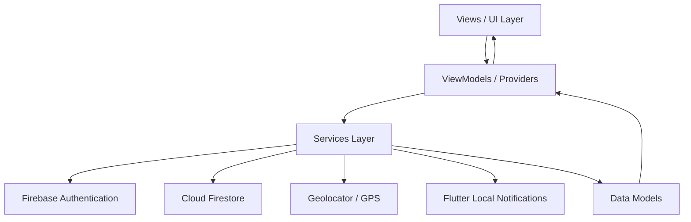

# ♻️ Metal Recycling App (EcoMetal)

A comprehensive, production-grade Flutter application designed for metal recycling discovery, scrap category identification, drop-off scheduling, and environmental impact tracking.

---

## 🏗️ Architecture & Project Structure

The project follows the **Model-View-ViewModel (MVVM)** architectural pattern combined with the `Provider` state management solution for separation of concerns, testability, and responsiveness.

```
metal_recycling_app/
├── android/                                  # Android-specific configurations & permissions (GPS, Internet)
│   └── app/src/main/AndroidManifest.xml
├── ios/                                      # iOS-specific configurations & permissions
│   └── Runner/Info.plist
├── lib/
│   ├── core/                                 # App-wide configurations, themes, and utilities
│   │   ├── constants/                        # API keys, app strings, theme colors
│   │   │   ├── app_colors.dart
│   │   │   ├── app_constants.dart
│   │   │   └── app_strings.dart
│   │   ├── utils/                            # Date formatters, validators, helpers
│   │   │   ├── date_formatter.dart
│   │   │   ├── helpers.dart
│   │   │   └── validators.dart
│   │   └── theme/                            # App theme and typography definitions
│   │       └── app_theme.dart
│   │
│   ├── models/                               # Data entities matching Firestore collections
│   │   ├── user_model.dart                   # userId, name, email, ecoPoints, totalRecycledKg
│   │   ├── service_model.dart                # serviceId, name, lat, lng, acceptedMetals, pricePerKg
│   │   ├── plan_model.dart                   # planId, userId, serviceId, metalType, date, status
│   │   └── activity_model.dart               # activityId, userId, planId, action, timestamp
│   │
│   ├── services/                             # External services and Firebase integrations
│   │   ├── auth_service.dart                 # Firebase Authentication wrapper with fallback
│   │   ├── database_service.dart             # Cloud Firestore CRUD operations & cache
│   │   ├── location_service.dart             # GPS & Mapping service integration
│   │   └── notification_service.dart         # Local notifications & scheduled reminders
│   │
│   ├── viewmodels/                           # State management (Provider pattern)
│   │   ├── auth_provider.dart                # Manages login/signup state & user session
│   │   ├── service_provider.dart             # Manages metal selection & service filtering
│   │   └── plan_provider.dart                # Manages recycling plans & activity history
│   │
│   ├── views/                                # User Interface screens organized by feature flow
│   │   ├── auth/
│   │   │   ├── login_screen.dart             # User login with validations and demo credentials
│   │   │   └── register_screen.dart          # Registration form with validation
│   │   ├── home/
│   │   │   └── metal_selection_screen.dart   # Select metal category (Aluminium, Copper, Steel, etc.)
│   │   ├── map/
│   │   │   └── service_discovery_screen.dart # Map & list view of recycling points with filters
│   │   ├── service/
│   │   │   └── service_detail_screen.dart    # Detailed view of selected recycling facility & rates
│   │   ├── plan/
│   │   │   └── plan_creation_screen.dart     # Create/update recycling plan & reminders
│   │   └── history/
│   │       └── activity_history_screen.dart  # User activity & past actions log
│   │
│   └── main.dart                             # Application entry point and MultiProvider setup
│
├── test/                                     # Functional test cases (TC01 - TC07)
│   ├── auth_test.dart                        # Tests TC01 & TC02
│   ├── plan_test.dart                        # Tests TC06 & TC07
│   └── service_discovery_test.dart           # Tests TC03, TC04 & TC05
│
├── analysis_options.yaml                     # Dart & Flutter code linting rules
├── pubspec.yaml                              # Dependencies (firebase, google_maps, provider, geolocator)
└── README.md                                 # Complete documentation & test case matrix
```

---

## 🔄 Architectural Flow



---

## 🧪 Functional Test Cases Matrix (TC01 – TC07)

The functional test suite is organized into three dedicated test suites under `test/`:

| Test ID | Test Category | Description | Test File |
| :--- | :--- | :--- | :--- |
| **TC01** | User Registration Validation | Validates email syntax, minimum password length (>= 6 chars), and name length. | [test/auth_test.dart](file:///c:/Users/HP/OneDrive%20-%20Rainbow%20Consult/Desktop/Metal%20Recycling%20App/test/auth_test.dart) |
| **TC02** | Authentication & User Entity | Tests `UserModel` serialization (`toMap`), deserialization (`fromMap`), and `copyWith`. | [test/auth_test.dart](file:///c:/Users/HP/OneDrive%20-%20Rainbow%20Consult/Desktop/Metal%20Recycling%20App/test/auth_test.dart) |
| **TC03** | Metal Category Selection | Verifies core categories (Copper, Aluminium, Steel, Brass, Lead) and scrap price validation. | [test/service_discovery_test.dart](file:///c:/Users/HP/OneDrive%20-%20Rainbow%20Consult/Desktop/Metal%20Recycling%20App/test/service_discovery_test.dart) |
| **TC04** | Service Discovery Filtering | Validates filtering recycling facilities by selected metal categories and multi-metal support. | [test/service_discovery_test.dart](file:///c:/Users/HP/OneDrive%20-%20Rainbow%20Consult/Desktop/Metal%20Recycling%20App/test/service_discovery_test.dart) |
| **TC05** | Geodesic Distance Sorting | Tests `LocationService.calculateDistance` between device coordinates and centers. | [test/service_discovery_test.dart](file:///c:/Users/HP/OneDrive%20-%20Rainbow%20Consult/Desktop/Metal%20Recycling%20App/test/service_discovery_test.dart) |
| **TC06** | Plan Creation & Validation | Tests weight validation (> 0 kg), date scheduling, scrap payout and carbon offset math. | [test/plan_test.dart](file:///c:/Users/HP/OneDrive%20-%20Rainbow%20Consult/Desktop/Metal%20Recycling%20App/test/plan_test.dart) |
| **TC07** | Status Progression & Audit Log | Verifies transitions (`pending` -> `confirmed` -> `completed` / `cancelled`) and `ActivityModel`. | [test/plan_test.dart](file:///c:/Users/HP/OneDrive%20-%20Rainbow%20Consult/Desktop/Metal%20Recycling%20App/test/plan_test.dart) |

---

## 🚀 Getting Started

### 1. Prerequisites
- **Flutter SDK**: `>= 3.0.0`
- **Dart SDK**: `>= 3.0.0 < 4.0.0`
- Android Studio / VS Code with Flutter extension
- Firebase project configured for Android and iOS

### 2. Dependency Installation
Run the following command in the project root:
```bash
flutter pub get
```

### 3. Running Functional Tests
Execute the automated test suite:
```bash
flutter test
```

### 4. Running the Application
```bash
flutter run
```

---

## 🔒 Permissions & Platform Setup

### Android (`android/app/src/main/AndroidManifest.xml`)
- `android.permission.INTERNET` & `ACCESS_NETWORK_STATE`: Firebase authentication & Cloud Firestore communication.
- `android.permission.ACCESS_FINE_LOCATION` & `ACCESS_COARSE_LOCATION`: Locates nearest recycling facilities using GPS.
- `android.permission.POST_NOTIFICATIONS` & `SCHEDULE_EXACT_ALARM`: Triggers scheduled morning reminders on appointment day.

### iOS (`ios/Runner/Info.plist`)
- `NSLocationWhenInUseUsageDescription`: Displays nearby metal drop-off points.
- `UIBackgroundModes`: Enables notification scheduling and background synchronization.

---

## 🗄️ Firestore Collections Schema

1. **`users`**: `{ userId, name, email, phone, totalRecycledKg, ecoPoints, createdAt }`
2. **`services`**: `{ serviceId, name, lat, lng, acceptedMetals, address, phone, operatingHours, rating, pricePerKg, isVerified }`
3. **`plans`**: `{ planId, userId, serviceId, serviceName, metalType, weightKg, date, status, notes, reminderEnabled, createdAt }`
4. **`activities`**: `{ activityId, userId, planId, action, title, description, weightKg, metalType, timestamp }`
